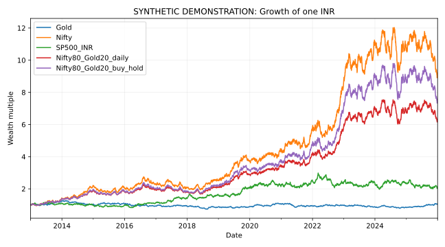

# Results walkthrough

All values below are synthetic or illustrative workflow results.

| Series | CAGR (%) | Volatility (%) | Maximum drawdown (%) |
| --- | --- | --- | --- |
| Gold | 0.347797 | 14.5012 | -41.8218 |
| Nifty | 18.629 | 19.3282 | -29.3139 |
| SP500_INR | 5.91025 | 18.4916 | -33.9697 |
| Nifty80_Gold20_daily | 15.2416 | 15.9372 | -26.6112 |
| Nifty80_Gold20_buy_hold | 16.8611 | 17.9996 | -28.3411 |

The daily-rebalanced and buy-and-hold allocations differ because the rebalancing rule changes the wealth path. The example does not identify a historically best investment.

The numerical files in [demo_output](../demo_output/) are the authoritative bundled artifacts. Re-run the entry command to reproduce the workflow. Figure metadata can differ across renders even when the underlying numerical example is unchanged.
